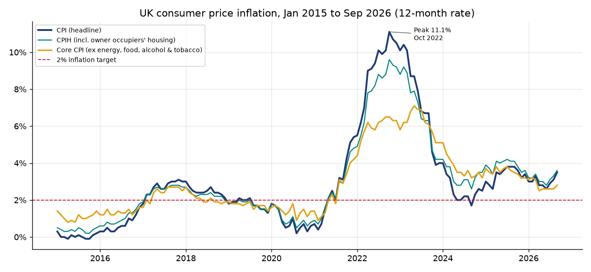
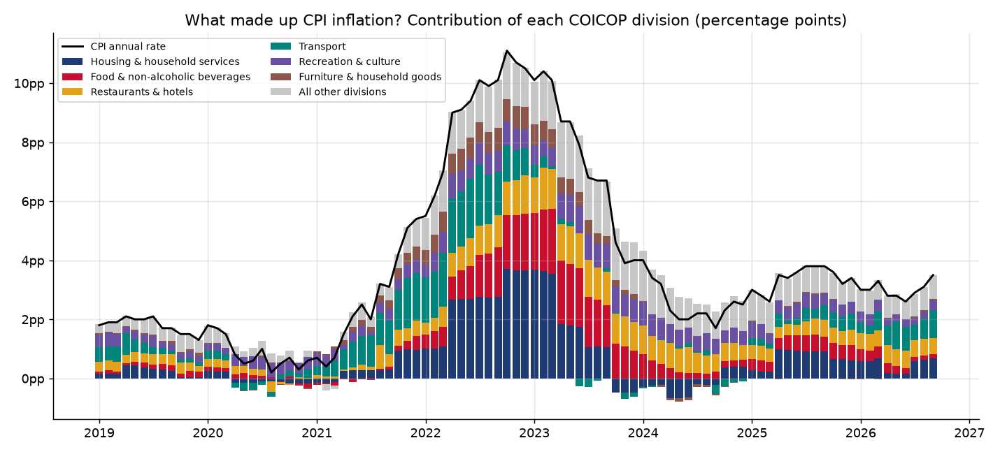
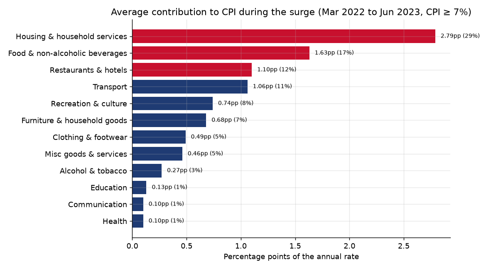
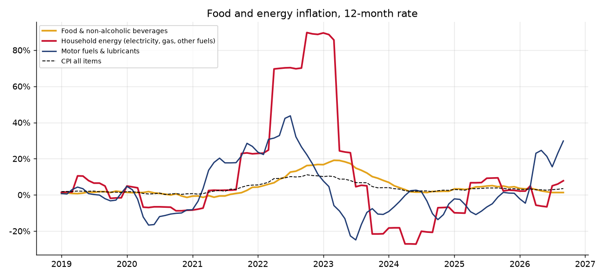
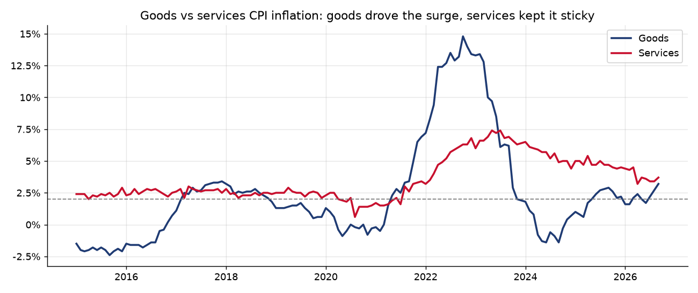
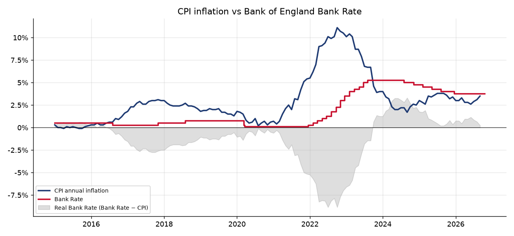
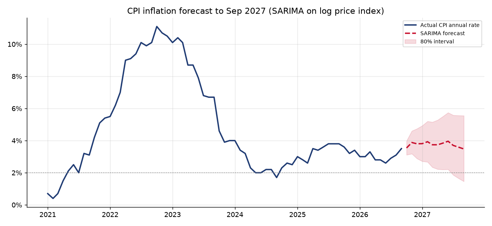
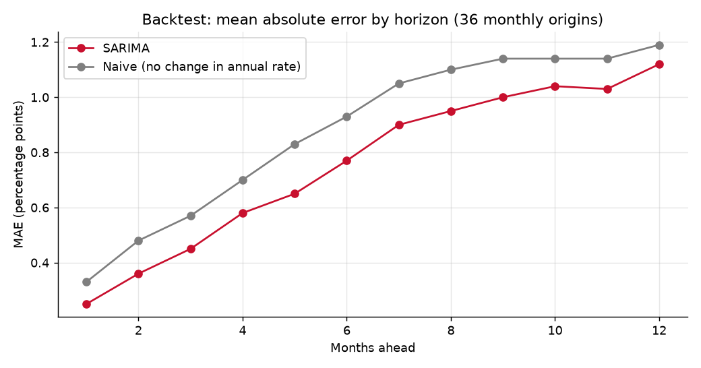

# UK consumer price inflation: what drove the 2022-23 surge, and where it is heading

An end-to-end analysis of UK consumer price inflation from official ONS data. It covers headline, core and CPIH
inflation since 2015, a contribution analysis of the COICOP divisions that drove the 2022-23 surge, food and energy
prices, how the Bank of England's Bank Rate responded, SQL analysis in DuckDB, a SARIMA forecast with a rolling backtest
and an interactive Streamlit dashboard.

Author: Anthony Adusei-Poku ([@anthony07-max](https://github.com/anthony07-max))



## Key findings (ONS data to September 2026, Bank Rate to 19 October 2026)

| Measure (12-month rate) | Peak (month) | September 2026 |
|---|---|---|
| CPI (headline) | **11.1%** (Oct 2022) | **3.5%** |
| CPIH | 9.6% (Oct 2022) | 3.6% |
| Core CPI (ex energy, food, alcohol & tobacco) | 7.1% (May 2023) | 2.8% |
| Services CPI | 7.4% (May 2023) | 3.7% |
| Goods CPI | 14.8% (Oct 2022) | 3.2% |

1. **Prices are 32.2% higher than in January 2021.** CPI averaged 1.54% a year in 2015-2019, then ran at 7% or
   more for 16 months in a row (March 2022 to June 2023, average 9.55%). Since 2021 there have been only 8 months
   at or below the 2% target, and none since the peak until May 2024.
2. **Housing & household services was the biggest driver of the surge.** This division includes electricity and gas.
   Across the 16 surge months it added an average of **2.79 percentage points** to CPI (29% of the rate). Food &
   non-alcoholic beverages added 1.63pp (17%) and restaurants & hotels added 1.10pp (12%). Together these three made
   up **57.8%** of surge inflation. At the October 2022 peak, housing & household services alone contributed 3.70pp,
   compared with −0.17pp two years earlier.
3. **The energy shock was extreme.** Household energy inflation (electricity, gas and other fuels) peaked at **89.7%**
   in October 2022, with gas at 129.4% and electricity at 66.7%. Motor fuels peaked at 43.7% in July 2022.
   **Food inflation peaked later, at 19.1% in March 2023**, and is now 1.3%.
4. **Goods drove the surge and services kept it sticky.** Goods inflation peaked first (14.8%, Oct 2022). Services
   and core inflation peaked seven months later (May 2023). Services inflation (3.7%) is still above goods (3.2%).
5. **The Bank of England raised Bank Rate 14 times** between 16 December 2021 and 3 August 2023, from 0.1% to
   **5.25%**. The real Bank Rate (Bank Rate minus CPI) fell to **−8.85 points in July 2022**. It did not turn
   positive until October 2023. The first cut came on 1 August 2024. Bank Rate is now 3.75%, only 0.25 points
   above CPI.
6. **What is driving inflation now is different.** In September 2026 transport made the largest contribution
   (0.94pp, up 0.43pp on a year earlier), followed by housing & household services (0.69pp). Energy as a whole is
   back to 17.9% annual inflation, while food's contribution has fallen to 0.14pp.
7. **Forecast:** a SARIMA(1,1,1)(0,1,1)12 model on the log CPI index projects CPI at **3.8% in December 2026** and
   **3.48% in September 2027** (80% interval 1.46% to 5.55%). In a rolling backtest from 36 monthly origins
   (Sep 2023 to Aug 2026), it beat a naive "no change" forecast at every horizon. The MAE was 0.25pp against 0.33pp
   one month ahead, 0.77pp against 0.93pp at six months, and 1.12pp against 1.19pp at twelve months.

| | |
|---|---|
|  |  |
|  |  |
|  |  |



## Method
- **Data extraction:** `src/clean.py` reads the full ONS MM23 file (about 4,000 series) and keeps the series used
  here by ONS series ID (CDID). It also converts the daily Bank Rate series to a month-end series.
- **Contribution analysis:** this uses the ONS's own published *contribution to the all-items CPI annual rate* for
  each of the 12 COICOP divisions (series WUMA to WUNG). These contributions add up to the headline rate, apart from a
  small rounding effect. The "surge" is every month in 2022-23 with CPI at 7% or more.
- **SQL:** the queries in [`sql/`](sql/) run in DuckDB against the tidy tables. They cover annual summaries, surge
  contributions, the peak-month breakdown, the real Bank Rate and the latest division ranking.
- **Forecast:** a seasonal ARIMA model fitted on the log CPI index (2015=100) from January 2010. The forecast index is
  turned into 12-month rates. For the backtest, the model is refitted at each of 36 monthly origins and forecasts 1 to
  12 months ahead, scored by mean absolute error against the published rate. The benchmark is a naive forecast that
  keeps the last observed annual rate.

| Group | Series used (ONS CDID) |
|---|---|
| Headline | CPI D7G7, CPIH L55O, Core CPI DKO8, Goods D7NM, Services D7NN, CPI index D7BT |
| Food & energy | Food & non-alc. beverages D7G8, Energy DKL5, Household energy D7GT, Electricity D7I7, Gas D7I8, Motor fuels D7IO |
| Divisions | Annual rates D7G8 to D7GJ, contributions WUMA to WUNG |

## Data sources
- **Office for National Statistics**: [Consumer price inflation time series (MM23)](https://www.ons.gov.uk/economy/inflationandpriceindices/datasets/consumerpriceindices),
  released 21 October 2026, data to September 2026. Contains public sector information licensed under the
  [Open Government Licence v3.0](https://www.nationalarchives.gov.uk/doc/open-government-licence/version/3/).
- **Bank of England**: [Official Bank Rate, series IUDBEDR](https://www.bankofengland.co.uk/boeapps/database/),
  from the Bank of England Statistical Interactive Database. Source: Bank of England, used under the Bank's
  [terms for reuse of its statistical data](https://www.bankofengland.co.uk/legal) with attribution.

## Project structure
```
src/download.py      # fetches the ONS MM23 CSV and Bank Rate into data/raw/
src/clean.py         # extracts headline, food/energy and COICOP division series, tidies Bank Rate
src/analysis.py      # runs the SQL, contribution analysis, SARIMA forecast and backtest, charts, key_findings.json
sql/                 # DuckDB SQL queries used by analysis.py
app/streamlit_app.py # interactive dashboard
charts/              # PNG outputs
data/processed/      # tidy CSVs and key_findings.json used by the dashboard
```

## How to run
```bash
python -m venv .venv && source .venv/bin/activate
pip install -r requirements.txt
./run_pipeline.sh                      # download, clean, analyse (about 1 minute)
streamlit run app/streamlit_app.py     # dashboard at http://localhost:8501
```
The ONS file is updated each month. When the pipeline is re-run it picks up the latest release, so the numbers above will change.

## Limitations
- The contribution analysis is at COICOP *division* level. Household energy sits inside "Housing & household
  services", so that division mixes energy with rents, water and maintenance. The separate energy series show how
  much of the shock was energy.
- CPI leaves out owner occupiers' housing costs. CPIH includes them and is shown alongside, but the contribution
  analysis and the forecast use CPI because that is the Bank of England's target measure.
- The SARIMA model is a univariate statistical baseline. It does not know about energy price caps, tax changes or
  policy decisions, and its 80% interval widens quickly. Treat it as a benchmark, not a central-bank-style projection.
- Index values in MM23 are rounded to one decimal place, which adds a little noise to annual rates derived from the
  forecast index.
- The real Bank Rate here uses current CPI inflation rather than expected inflation, so it is a backward-looking measure.
